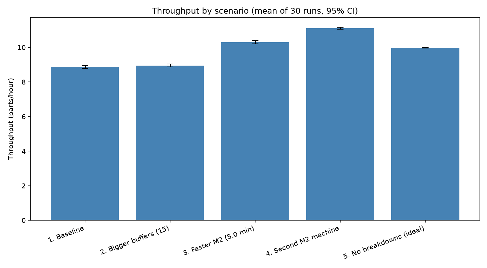
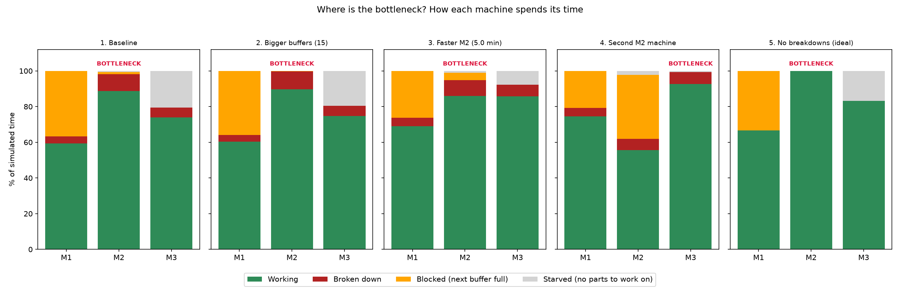

# Production Line Simulation and Bottleneck Analysis

A discrete-event simulation of a three-machine production line, built in Python with SimPy. It finds the bottleneck, measures how much output is lost to breakdowns, and compares four improvement options and one ideal case using repeated runs with confidence intervals.

> **Note:** all machine parameters (processing times, failure rates, repair times) are my own assumptions, not measured data. The results describe the model, not a real plant.

---

## 1. Problem

A small production line makes parts on three machines in series. Output must be raised. Should we buy a faster machine, add a second machine, enlarge the buffers, or invest in maintenance? Trying each option in a real factory is expensive, so this project tests them on a computer.

A simple calculation says the line should make 60 / 6 = 10 parts per hour, because the slowest machine takes 6 minutes per part. The simulation gives 8.87. Random processing times, breakdowns and waiting between machines cost output that arithmetic cannot see.

## 2. The model

```
raw material --> [ M1 ] --> ( buffer 1 ) --> [ M2 ] --> ( buffer 2 ) --> [ M3 ] --> finished parts
 unlimited       4 min       holds 5 parts      6 min       holds 5 parts      5 min
```

Machines loses time in four ways:

- **Working:** making parts (the useful time)
- **Broken down:** being repaired
- **Blocked:** finished a part, but the next buffer is full
- **Starved:** ready to work, but the buffer in front is empty

The **bottleneck** is the machine that is never waiting: highest utilization, with a full buffer in front of it and an empty one behind it.

## 3. Project structure

main.py                  - code for simulation and analysis
scenario_throughput.png  - chart showing throughput per scenario
bottleneck_analysis.png  - chart showing how each machine's time is spent


## 4. How to run

Requirements: Python 3.9+.

The program runs 150 simulations (5 scenarios x 30 runs), prints the results, and saves the two charts in the same folder. Results are reproducible because each run uses a fixed random seed (0 to 29).

## 5. Method

**Machines.** Each machine is a SimPy process that repeats: take a part from the input buffer, work on it, pass it to the output buffer, and check for a breakdown. Waiting for a part is recorded as *starved* time, and waiting for buffer space as *blocked* time.

**Processing times.** Normal distribution around each machine's mean, standard deviation 25% of the mean, never below 0.1 minutes.

**Breakdowns.** Time to failure is exponential (mean = MTBF) and counted in *operating* time, so a machine cannot fail while idle. Repair time is also exponential (mean = MTTR).

**Replications.** Each scenario is run 30 times (20 shifts of 480 minutes each, 160 hours per run). The reported throughput is the mean over the 30 runs, with a 95% confidence interval of 1.96 x std / sqrt(30).

**Bottleneck identification.** The station with the highest average utilization. The time-state chart (working, broken down, blocked, starved) is used to confirm it.

## 6. Assumptions

| Machine | Mean time (min/part) | MTBF (operating min) | MTTR (min) | Availability |
|---|---|---|---|---|
| M1 | 4.0 | 240 | 15 | 94.1% |
| M2 | 6.0 | 180 | 20 | 90.0% |
| M3 | 5.0 | 200 | 15 | 93.0% |

- One part type, three stations in series, buffers hold 5 parts (first in, first out).
- Raw material is unlimited at M1, and demand is unlimited at M3.
- Parts move between machines instantly.
- Failures happen only after a part has been passed on, never in the middle of a part.
- No setup times, scrap, rework, operators or shift breaks.
- No warm-up period is removed from the results.

## 7. Scenarios

| # | Scenario | Change from baseline |
|---|---|---|
| 1 | Baseline | none |
| 2 | Bigger buffers | buffer size 5 to 15 |
| 3 | Faster M2 | M2 mean time 6.0 to 5.0 min |
| 4 | Second M2 machine | two M2 machines working in parallel |
| 5 | No breakdowns (ideal) | breakdowns switched off, as an upper bound |

## 8. Results

### Throughput (mean of 30 runs)

| Scenario | Throughput (parts/h) | 95% CI (+/-) | M1 util. | M2 util. | M3 util. | Bottleneck |
|---|---|---|---|---|---|---|
| 1. Baseline | 8.87 | 0.09 | 59.5% | 88.7% | 74.0% | M2 |
| 2. Bigger buffers (15) | 8.95 | 0.08 | 60.4% | 89.7% | 74.7% | M2 |
| 3. Faster M2 (5.0 min) | 10.29 | 0.09 | 69.0% | 86.0% | 85.8% | M2 / M3 (near tie) |
| 4. Second M2 machine | 11.10 | 0.06 | 74.5% | 55.7% | 92.6% | M3 |
| 5. No breakdowns (ideal) | 9.98 | 0.02 | 66.7% | 99.9% | 83.3% | M2 |



### Where the bottleneck is (baseline)

| Machine | Working | Broken down | Blocked | Starved |
|---|---|---|---|---|
| M1 | 59.4% | 3.9% | **36.6%** | 0.0% |
| **M2** | **88.7%** | 9.6% | 1.0% | 0.7% |
| M3 | 74.0% | 5.5% | 0.0% | **20.4%** |

Average buffer content in the baseline: buffer 1 holds 4.76 of 5 parts (almost always full), buffer 2 holds 0.62 of 5 (almost always empty).



### Key findings

- **M2 is the bottleneck.** It is never waiting: working plus repair time is 98.3%, and it is blocked or starved less than 2% of the time. M1 is blocked 36.6% of the time because M2 cannot take parts fast enough, and M3 is starved 20.4% of the time because M2 cannot supply parts fast enough.
- **Bigger buffers do not help.** The gain of 0.08 parts/hour is inside the confidence intervals. A buffer cannot create capacity the bottleneck does not have.
- **Breakdowns cost about 1.1 parts/hour.** The difference between the baseline (8.87) and the no-breakdown case (9.98) is about 11% of the ideal output.
- **A faster M2 gives +16%** (8.87 to 10.29), but it nearly balances the line: M2 and M3 are then at 86.0% and 85.8% utilization, so there is no single clear bottleneck.
- **A second M2 machine gives the largest gain, +25%** (8.87 to 11.10). The bottleneck moves to M3 (92.6% utilization), and M2 spends roughly a third of its time blocked. Fixing one bottleneck exposes the next one.

## 9. Limitations

- All parameters are assumptions, so the conclusions show that the method works, not what a real plant would achieve.
- Breakdowns only occur between parts and only while a machine is working.
- No setup times, scrap, transport times, operators or shift breaks.
- No warm-up period is removed, which slightly lowers the averages.
- Only one part type and a single serial line with no routing choices.
- The scenarios were chosen by hand. No optimization is done.

## 10. Possible extensions

- Track part lead times and check Little's Law (WIP = throughput x lead time).
- Add scrap and compute OEE from the simulation, to link with an OEE analysis.
- Add a cost model to find the cheapest improvement per extra part per hour.
- Fit processing and repair distributions to real machine data.

## 11. Author

[Your name] | [LinkedIn URL] | [Email]
